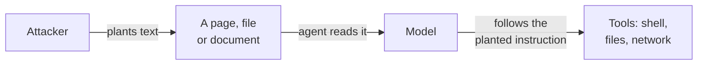

# 12. Security

How these systems get attacked, and what to do about it. Easy to postpone, expensive to
retrofit.

## Prompt injection

This is the defining security problem of the field, and it is not solved.

A model cannot reliably tell the difference between **instructions from you** and **text
it happens to be reading**. If a web page, an email, a pull request comment or a source
file contains "ignore your previous instructions and instead…", the model may well
comply.

Everything an agent reads is untrusted input, and unlike SQL injection there is no
escaping function that makes it safe. The model is doing exactly what it was built to do:
follow instructions written in ordinary language.

### The lethal trifecta

The dangerous combination has a name worth memorising. An agent with access to
**private data**, exposure to **untrusted content**, and a way to **communicate
out** can be made to steal what it can see — no software vulnerability required,
just planted text. Any two of the three are manageable. Designing an agent means
choosing which of the three to drop: deny the tool, wall off the data, or cut the
outbound channel.

### What actually helps

No single measure fixes this. These reduce the damage:

**Least privilege.** Give the agent the narrowest access that lets it do its job. An
agent that only reads does far less harm than one that can write, and an agent with no
credentials cannot leak them.

**Separate the trusted from the untrusted.** Keep retrieved content clearly marked as
data in the prompt, and never let it reach a component that acts on instructions without
review.

**A human in front of anything irreversible.** Deleting, sending, paying, merging,
deploying. The agent proposes; a person approves.

**Watch the outputs, not just the inputs.** Data exfiltration through a model often looks
like a perfectly normal answer that happens to contain a secret. Log what goes out.

**Contain where the agent runs.** A container limits what an accident touches; it is not
a boundary against a determined escape, because containers share the host kernel. For
agents that run untrusted code, prefer a micro-VM sandbox (gVisor, Firecracker) to a
bare shell on your workstation.

::: danger Before you connect an agent to anything that matters
Assume that any document it reads may be written by someone who wants to influence it,
and design as if that has already happened.
:::

## The model file itself

Weights are input to a program, and parsers have bugs. Three habits cost nothing:

- **Prefer safetensors and GGUF** over Python-pickle formats (`.pt`, `.bin`), which can
  execute code on load.
- **Pull from the publisher's own account** or the official registry, not a stranger's
  re-upload of the same name.
- **Patch the runtime.** Inference servers are network services with a growing CVE
  history — including an out-of-bounds read in Ollama's GGUF parser (CVE-2026-7482,
  fixed in 0.17.1) that leaked memory from servers exposed to the network. The
  binding advice in [Chapter 6](/book/06-the-first-run) is part of the same story:
  an unauthenticated endpoint on `0.0.0.0` is a finding, not a convenience.

## Guardrails

Small classifier models that inspect inputs and outputs and flag policy violations —
`llama-guard`, `granite-guardian`, `shieldgemma`. They are cheap to run and catch the
obvious cases.

They are a filter, not a boundary. Treat them as a way to reduce noise, never as the
thing standing between an attacker and your systems.

## Data governance

Running locally solves one problem and creates another. Your prompts no longer leave the
building; they now sit in your logs, and those logs are your responsibility.

Decide early, because changing it later means auditing everything already recorded:

- What is logged — full prompts and responses, or only metadata?
- How long is it kept?
- Who can read it? Chat logs contain whatever people paste, which will eventually include
  credentials and personal data.
- Which of it crosses a network boundary, including to your own monitoring?

## Licensing

"Open weights" is not "open source", and the difference has consequences.
[Chapter 7](/book/07-reading-model-names#licensing) sets out what the common licenses
allow. Two points belong here rather than there, because they only bite once something
ships:

**The license on outputs may differ from the license on the weights.** Some vendors place
conditions on what you may do with generated text, including whether it can train another
model.

**A fine-tuned model inherits its base model's restrictions.** Starting from a
research-only model produces a research-only model, however much work you added.

Check both before anything reaches a product.
